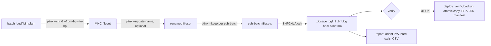

# HLA Pipeline Manager

[](https://github.com/dsugurtuna/hla-pipeline-manager/actions/workflows/ci.yml)
[](https://www.python.org/downloads/)
[](LICENSE)

Plan, verify, report, and safely deploy SNP2HLA imputation across genotyping batches.

> **Note:** Independent open-source reference implementation inspired by biobank-scale clinical genomics workflows. Built from scratch on synthetic data; contains no employer code, proprietary tooling, or real participant data.

## The problem

Imputing classical HLA alleles across large array cohorts means splitting each batch into sub-batches, running SNP2HLA (PLINK plus Beagle 3) on every sub-batch, and validating thousands of output files before anything reaches downstream consumers. A sub-batch that silently failed, an inverted `P`/`A` allele count, or a release directory overwritten without a backup and checksum manifest is expensive to discover after release.

## What this does

- **Plans a batch (`plan`).** Builds the exact PLINK and SNP2HLA commands: extract the extended MHC on chromosome 6 (26-34 Mb by default), optionally rename Affymetrix `AX-` probe IDs to rsIDs with `--update-name`, split samples into `.keep` sub-batches, and invoke `SNP2HLA.csh` per sub-batch. A dry-run plan emits commands without mutating `--work-dir`; execution (`dry_run=False`) is an explicit call through an injectable runner.
- **Verifies outputs (`verify`).** Checks every discovered sub-batch for non-empty `.bed`, `.bim`, `.fam`, `.dosage`, `.bgl.r2`, and `.bgl.log` files, verifies HLA allele markers (`HLA_*`) appear in `.bim` and `.bgl.r2`, and enforces a non-error Beagle completion line in the log tail. Fails closed (exit code `1`) on empty directories, missing paths, or incomplete sub-batches.
- **Reports allele carriers (`report`).** Reads PLINK `--recode A` (`.raw`) or SNP2HLA `.dosage` files (consistently omitting `NA` entries), flips `P`/`A` orientation when `HLA_` markers count the absent (`A`) allele, rejects non-finite or out-of-range dosages, applies hard-call thresholds, and attaches Beagle `r2`.
- **Deploys with backup, verification gate, and rollback (Python API).** Validates source batches with `ImputationVerifier` before touching the release folder, takes a microsecond-timestamped backup, copies all six SNP2HLA output suffixes atomically via `.tmp` + `os.replace()`, verifies every file by SHA-256, rolls back from backup on mismatch, removes stale release files, and writes `SHA256SUMS.tsv`.

## Quickstart

Uses the synthetic files in [`examples/`](examples/README.md); no PLINK, Java, or reference panel needed.

```bash
git clone https://github.com/dsugurtuna/hla-pipeline-manager.git
cd hla-pipeline-manager
python3.11 -m venv .venv && source .venv/bin/activate
pip install -e ".[dev]"
pytest

# 1. Plan a batch of 12 synthetic samples in sub-batches of 5 (dry run; no files written)
hla-pipeline plan --batch-id demo --bfile examples/synthetic \
  --work-dir /tmp/hla-demo --reference HM_CEU_REF --sub-batch-size 5

# 2. Verify two synthetic sub-batch outputs; sub_batch_002_imputed lacks a log, so exit code is 1
hla-pipeline verify examples/batch --expected 2

# 3. Carrier report for HLA-DRB1*04:01 from a synthetic SNP2HLA .dosage file
hla-pipeline report examples/batch/sub_batch_001_imputed.dosage \
  --fam examples/batch/sub_batch_001_imputed.fam --allele HLA_DRB1_0401 \
  --r2 examples/batch/sub_batch_001_imputed.bgl.r2
```

(`python -m hla_pipeline ...` and `hla-pipeline ...` are equivalent.)

The same planning and deployment steps from Python:

```python
from hla_pipeline import BatchExecutor, PipelineConfig, ResultDeployer

config = PipelineConfig(reference_panel="HM_CEU_REF", sub_batch_size=5)
plan = BatchExecutor(config).plan_batch(
    "demo", "examples/synthetic", "/tmp/hla-demo", write_files=False
)
for argv in plan.commands:
    print(" ".join(argv))

# Deployment requires a directory passing ImputationVerifier (require_verified=True)
# report = ResultDeployer("/path/to/release").deploy("/path/to/verified_batch")
```

To run a plan for real, call `execute_batch(..., dry_run=False)` on a machine with PLINK 1.9, Java, and SNP2HLA installed. PLINK steps of a plan were smoke-tested with PLINK v1.90b7.2 on synthetic chromosome 6 data (region extraction, `--update-name` renaming, and `--keep` sub-batches all behaved as planned); SNP2HLA itself is external and was not executed locally.

## Architecture



| Module | Role |
| :--- | :--- |
| `executor.py` | Validates batch IDs and config, builds plans, runs commands via an injectable runner |
| `verifier.py` | Fail-closed completeness checks across sub-batches, directories, and Beagle logs |
| `dosage.py` | Readers for `.raw`, SNP2HLA `.dosage` (`NA`-safe), and `.bgl.r2` |
| `reporter.py` | Dosage validation (`[0, 2]`, finite), hard calls, and CSV export |
| `deployer.py` | Pre-deploy verification gate, timestamped backup, atomic copy, rollback, and `SHA256SUMS.tsv` |
| `__main__.py` | `hla-pipeline` / `python -m hla_pipeline` CLI (`plan`, `verify`, `report`) |

## Design decisions

- **Planning is separate from running.** Plans can be inspected, logged, and tested without external tools (`write_files=False` and `execute_batch(..., dry_run=True)` never write to disk); `completed` only counts sub-batches whose commands exited with status 0, never treating planned steps as succeeded.
- **Commands go through an injectable runner.** Unit tests replace PLINK and SNP2HLA with a callable `Runner`, testing single-sub-batch failure and shared-step abort in milliseconds without a cluster.
- **Sub-batches come from the input `.fam`.** Region filtering drops variants rather than samples, so the sample split is deterministic before any tool runs. `.keep` files avoid PLINK overwriting its own `.fam` input.
- **Present-allele dosage is explicit.** PLINK `--recode A` counts `A1`, and SNP2HLA `.dosage` counts `allele1`. For `HLA_` markers only, both readers flip `x -> 2 - x` when the counted allele is `A` (absent), leaving standard SNPs (`A` = adenine) untouched.
- **Fail-closed verification replaces traditional shell wrappers.** Checks non-empty outputs, `HLA_` markers in `.bim` and `.bgl.r2`, and a word-bounded Beagle completion line without error/negation markers; rejects empty or nonexistent directories, and discovers sub-batches via `*.dosage` so input filesets in the same directory are not miscounted.
- **Deployment is deliberate and atomic.** Excluded from the CLI to prevent accidental release overwrites; enforces `ImputationVerifier` by default, deploys all six SNP2HLA suffixes via `.tmp` + `os.replace()`, rolls back from backup on SHA-256 mismatch, cleans stale release files, and persists `SHA256SUMS.tsv`.

## Limitations and what it is not

- Does not wrap a cluster scheduler. `execute_batch` runs commands sequentially; cluster runs hand planned commands to Slurm or SGE.
- Beagle completion checking relies on configurable log-tail markers (`finished`, `completed`, `end time`) paired with negative/error-line filtering.
- Hard calls (`>= 1.5` homozygous, `> 0.5` heterozygous) are convenience carrier thresholds, not clinical HLA calls, and discard dosage uncertainty (`r2` is included beside every row).
- Verifies output structure and file integrity, not imputation accuracy (which requires lab-typed validation samples).
- Targets SNP2HLA's output layout rather than CookHLA or HIBAG.

## Where this fits

Part of a curated set of public clinical genomics and health-data reference architectures, alongside [genomic-cohort-delivery-pipeline](https://github.com/dsugurtuna/genomic-cohort-delivery-pipeline) (multi-batch PLINK cohort assembly and verified delivery) and [clinical-cohort-ai-platform](https://github.com/dsugurtuna/clinical-cohort-ai-platform) (clinical research platform reference architecture).

## Roadmap

- Emit the execution plan as a Slurm array job script.
- Record tool versions and input checksums in a run manifest.
- Support CookHLA output alongside SNP2HLA.

## Licence

MIT. See [LICENSE](LICENSE).

---

Personal project by [Ugur Tuna](https://github.com/dsugurtuna). Not affiliated with or endorsed by any employer.
